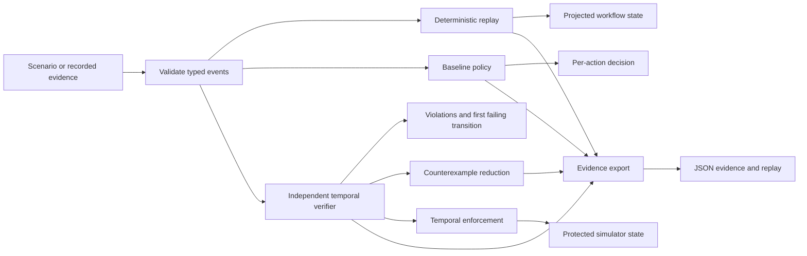
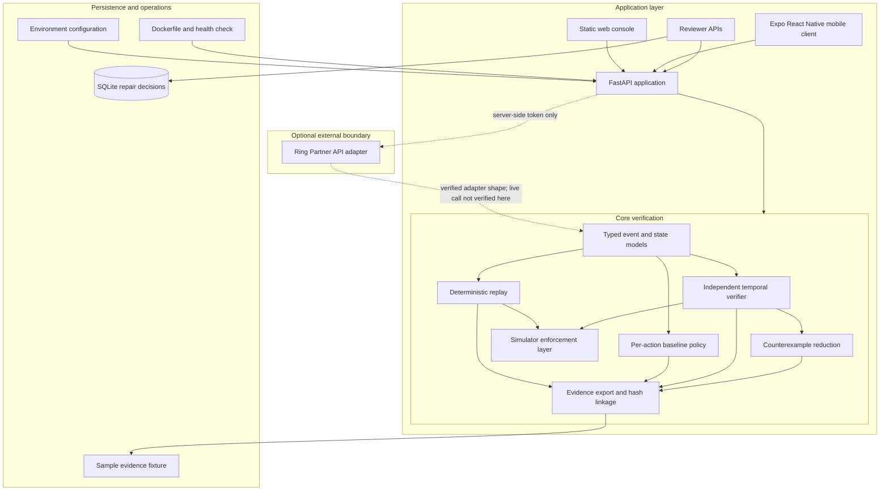

# Veylith — Temporal Safety Assurance for Autonomous AI Agents

> **Every action may be authorized. Every sequence must be safe.**

Veylith is an open-source prototype for testing whether an independent,
deterministic temporal verifier can catch unsafe workflow transitions that a
simplified per-action authorization check misses.

It models approvals, revocations, event ordering, evidence freshness, retries,
duplicate delivery, provenance, and protected state transitions. The bundled
demonstration is intentionally reproducible: the same event stream is evaluated
by a transparent baseline, a temporal verifier, and a simulator-side enforcement
layer.

> **Scope:** Veylith is a finite, deterministic verification laboratory. It is
> not a universal AI-agent security solution, a formal proof of arbitrary
> executions, or a replacement for authentication, authorization, runtime
> governance, testing, or independent security review.

## At a glance

| Area | Current status |
| --- | --- |
| Core verifier | Implemented and covered by the Python test suite |
| Flagship experiment | Reproducibly demonstrates baseline allow vs. temporal reject |
| Web console | FastAPI-served static security operations console |
| Mobile client | Expo / React Native / TypeScript MVP; type-checked and Expo-validated |
| Review workflow | Demo bearer sessions; reviewer-gated decisions persisted in SQLite |
| Ring adapter | Documented server-side adapter with mocked tests; live Veylith-to-Ring call not verified in this workspace |
| Public deployment | Not verified; no public URL is claimed |

## Table of contents

- [Overview](#overview)
- [Why temporal safety matters](#why-temporal-safety-matters)
- [Key features](#key-features)
- [Flagship experiment](#flagship-experiment)
- [Additional scenarios](#additional-scenarios)
- [How Veylith works](#how-veylith-works)
- [Architecture](#architecture)
- [Temporal safety model](#temporal-safety-model)
- [Web application](#web-application)
- [Mobile application](#mobile-application)
- [API reference](#api-reference)
- [Technology stack](#technology-stack)
- [Repository structure](#repository-structure)
- [Quick start](#quick-start)
- [Configuration](#configuration)
- [Testing and quality assurance](#testing-and-quality-assurance)
- [Evidence and auditability](#evidence-and-auditability)
- [Security model](#security-model)
- [Ring integration status](#ring-integration-status)
- [Deployment](#deployment)
- [Scientific and technical limitations](#scientific-and-technical-limitations)
- [Roadmap](#roadmap)
- [Contributing](#contributing)
- [License](#license)
- [Acknowledgments](#acknowledgments)

## Overview

Veylith is designed for engineers who need to answer a narrower question than
“was this tool call authorized?”:

> **Was the entire workflow still safe when the protected transition occurred?**

The project targets AI-agent developers, application-security engineers,
distributed-systems engineers, AI-safety researchers, reliability engineers,
and judges evaluating reproducible safety claims.

The implementation intentionally separates:

1. **A simplified baseline policy** that checks whether a request, approval, and
   execution are present.
2. **An independent temporal verifier** that evaluates the relationship between
   events across the trace.
3. **Simulator enforcement** that prevents unsafe execution events from changing
   protected simulated state.

The baseline is a transparent reference implementation, not a claim about the
behavior of every production governance system.

## Why temporal safety matters

Per-action checks can be locally correct and still produce an unsafe sequence:

- An approval can be valid during planning and revoked before execution.
- Event delivery can be delayed, duplicated, or processed out of order.
- Evidence can be stale relative to the state at the commit boundary.
- A timeout can leave execution uncertain; a retry can then duplicate an effect.
- Untrusted event content can try to rewrite an agent's instructions.
- A repair can appear plausible without actually removing the original failure.

Temporal verification evaluates these relationships over an execution history. It
does not replace ordinary authorization. It adds an independently inspectable
transition-level check and a reproducible explanation when the sequence violates
an invariant.

## Key features

### Event-sourced workflow model

`chronicle_guard.model.Event` supports the following fields:

- `id`
- `workflow_id`
- `kind`
- `source`
- `at`
- `event_time`
- `processing_time`
- `sequence`
- `correlation_id`
- `entity_id`
- `provenance`
- `actor`
- `action_id`
- `approval_id`
- `evidence_id`
- `state_outcome`
- `payload`

`event_time` is the time the fact occurred. `processing_time` is when the
simulator or adapter received it. The verifier uses logical event time while
preserving the received stream order for analysis.

### Deterministic replay

`chronicle_guard.state.replay()` reconstructs `GuardState` from an ordered event
list. Applying the same list produces the same state. Event IDs act as
idempotency keys during replay: a repeated event is ignored in state
application, while the verifier can still report the duplicate in the original
trace.

Replay reconstructs a recorded or generated trace. It does **not** run an
autonomous language-model agent and does not prove that an external system would
behave identically.

### Independent temporal verifier

`chronicle_guard.verifier.verify()` checks the full trace independently of the
baseline policy. The current implementation detects:

- Approval revocation before execution.
- Approval expiry when an approval carries an `expires_at` payload value.
- Missing or invalid approvals at execution time.
- Stale evidence and evidence without an execution anchor.
- Out-of-order logical event time.
- Duplicate event IDs and duplicate approvals.
- Duplicate executions and retry reuse after uncertain execution.
- Execution without a request.
- Untrusted-instruction events attempting to change authorization behavior.

The result includes `valid`, all violations, checked event IDs, the first
violation event ID, and the verifier version. This is bounded explicit trace
verification, not exhaustive model checking.

### Temporal enforcement

`enforce_temporal()` incrementally evaluates execution events before applying
them to the protected simulator state. Unsafe execution events are kept in the
raw forensic stream but are excluded from the protected state.

This distinction matters: Veylith can block a simulated state transition. It
does not automatically secure arbitrary third-party agents or real-world
devices unless a separately verified integration explicitly provides that
capability.

### Counterexamples and reduction

`reduce_counterexample()` greedily removes events while preserving the first
observed violation code. It is a practical reduction heuristic, not a proof that
the result is globally minimal.

For the flagship race, the reduced trace is:

```text
e2 → e3 → e4
```

That means:

1. `e2`: approval granted.
2. `e3`: approval revoked.
3. `e4`: execution attempted.

### Repair validation and reviewer decisions

`POST /api/repair/validate` validates a candidate repair by removing the
requested event IDs, re-running the verifier, and returning the original result,
repaired result, repaired events, and `valid_repair`.

The reviewer API is separate:

- `GET /api/chronicle/repairs` derives findings from actual scenario/verifier
  output.
- `POST /api/chronicle/repairs/{finding_id}/decision` accepts `approve` or
  `reject` only for a valid `reviewer` bearer session.
- Decisions are persisted in SQLite at `VEYLITH_DATA_PATH`.

A reviewer decision annotates a finding. It does not automatically modify the
verifier, apply a policy patch, or guarantee that the repair is correct.

### Evidence export

`chronicle_guard.export.evidence_export()` returns deterministic JSON containing:

- Evidence format identifier.
- Event count and serialized events.
- A SHA-256 hash-linked sequence with `event_id`, `previous_hash`, and `hash`.
- Verification result and violations.
- Replayed state when `include_state` is enabled.
- Enforcement result and protected state when state is included.

Hash linkage makes later changes detectable. It does not prove that an upstream
event was authentic or truthful, and it is not a digital signature, trusted
timestamp, immutable database, or independently trusted chain of custody.

## Flagship experiment

### Revoked approval race — `SCN-042 / revoked_approval_race`

The bundled scenario is a controlled test of the hypothesis that a temporal
verifier can detect a dangerous execution transition missed by a simplified
per-action baseline.

| Event | Meaning |
| --- | --- |
| `e1` | Action requested. |
| `e2` | Approval `ap-1` granted. |
| `e3` | Approval `ap-1` revoked. |
| `e4` | Sensitive action execution attempted. |
| `e5` | Evidence recorded after the attempted execution. |

The bundled deterministic result is:

| Result | Observed outcome |
| --- | --- |
| Simplified baseline policy | **Allowed** |
| Independent temporal verifier | **Rejected** |
| First failing transition | `e4` |
| Violation | `revoked_approval_race` |
| Temporal enforcement | Blocked `e4` |
| Protected execution state | Remained unexecuted (`executed_at = null`) |
| Reduced counterexample | `e2 → e3 → e4` |

These are results of the bundled deterministic experiment, not universal
benchmark findings. The comparison views are three evaluator views over the same
controlled trace: raw simulator behavior, the simplified baseline, and the
baseline plus Veylith verification/enforcement. They are not three independent
model-driven agents.

The baseline intentionally checks request/approval/execution presence and does
not bind approval validity to the execution boundary. A different baseline may
already reject this sequence.

Run it from the repository root:

```bash
python -m chronicle_guard.cli run revoked_approval_race
```

Replay the saved evidence fixture:

```bash
python -m chronicle_guard.cli replay evidence/sample-revoked-approval-race.json
```

### Additional scenarios

The scenario catalog in `chronicle_guard/scenarios.py` contains nine deterministic
scenarios. The observed primary findings below are derived from the current
verifier; they are synthetic demonstrations, not production incident reports.

| Scenario | Condition exercised | Current observed result | Does not establish |
| --- | --- | --- | --- |
| `happy_path` / `SCN-001` | Fresh request, approval, execution, and evidence. | Valid; protected execution succeeds. | Safety of arbitrary legitimate workflows. |
| `revoked_approval_race` / `SCN-042` | Approval revoked before execution. | `revoked_approval_race`; execution blocked. | That every real policy engine would allow it. |
| `stale_approval` / `SCN-028` | Approval arrives after execution. | Execution lacks a valid approval. | Real-world approval-service behavior. |
| `duplicate_event` / `SCN-031` | Same event ID delivered twice. | `duplicate_event`; replay ignores the repeated ID. | Distributed-system correctness under every delivery model. |
| `execute_without_approval` / `SCN-007` | Execution without approval. | `execution_without_approval`. | Protection of an external action. |
| `stale_evidence` / `SCN-019` | Evidence arrives before its execution anchor. | `stale_evidence` plus the applicable execution authorization result. | Authenticity or truth of evidence sources. |
| `out_of_order` / `SCN-017` | Logical event time moves backwards. | `out_of_order`. | Clock synchronization in production. |
| `network_timeout` / `SCN-023` | Uncertain tool outcome followed by retry. | Duplicate execution and retry/idempotency violations. | A complete exactly-once guarantee. |
| `untrusted_instruction` / `SCN-029` | Untrusted event content attempts to rewrite instructions. | `untrusted_instruction` and unsafe execution is rejected. | General prompt-injection coverage. |

## How Veylith works



The implemented flow is:

1. Load a deterministic scenario or validate a supplied event list.
2. Reconstruct state with `replay()`.
3. Evaluate the transparent baseline policy.
4. Evaluate temporal invariants independently.
5. Identify violations and the first failing transition.
6. Reduce a counterexample when a violation exists.
7. Apply the enforcement decision to simulated protected state.
8. Export evidence and hash-linked event history.
9. Validate candidate repairs by replaying a modified event list.
10. Record reviewer decisions separately when an authorized reviewer approves or
    rejects a finding.

No cloud agent fleet, production model service, live Ring event stream, or
unshown ingestion pipeline is implied by this diagram.

## Architecture



### Component responsibilities

| Component | Responsibility |
| --- | --- |
| `chronicle_guard.model` | Pydantic records for events, state, scenarios, requests, findings, and decisions. |
| `chronicle_guard.state` | Pure replay and duplicate-event state handling. |
| `chronicle_guard.policy` | Transparent presence-based baseline. |
| `chronicle_guard.verifier` | Temporal invariants, violations, reduction, and simulator enforcement. |
| `chronicle_guard.scenarios` | Deterministic synthetic scenario factories with IDs, versions, and seeds. |
| `chronicle_guard.repair` | Candidate repair validation by dropping event IDs and re-verifying. |
| `chronicle_guard.export` | JSON evidence and hash-linked event history. |
| `chronicle_guard.ring` | Isolated server-side Ring request adapter and provenance mapper. |
| `chronicle_guard.storage` | SQLite persistence for reviewer repair decisions. |
| `chronicle_guard.app` | FastAPI routes, demo auth, static-file serving, and client-facing API. |
| `chronicle_guard.cli` | Scenario execution and evidence replay from the command line. |
| `static/index.html` | Web-console structure and view sections. |
| `static/styles.css` | Responsive dark engineering-console styling. |
| `static/app.js` | Web navigation, API calls, trace rendering, exports, review flow, and Ring status UI. |
| `apps/mobile` | Expo/React Native client using the FastAPI API as its source of truth. |

The verifier is deterministic and independent of an LLM so that a finding can be
replayed, compared, reduced, and tested without paid model APIs or model-output
claims about safety.

## Temporal safety model

The replay state contains requested actions, approval lifecycle, evidence
records, applied event IDs, ignored duplicate IDs, and a monotonic logical clock.
The core invariants are expressed operationally as:

- `G(execute(action) -> request_seen(action))`
- `G(execute(action) -> exists approval(action) valid_at(execution_time))`
- `G(evidence(action) -> execution_anchor(action) && evidence_time >= execution_time)`
- `G(event_id -> unique(event_id))`
- `G(retry -> idempotency_key has not already committed)`
- `G(untrusted_instruction -> cannot change authorization state)`
- Logical event time must not move backwards in the processed trace.

Here `G` means “throughout the checked trace.” The implementation reports the
first event associated with a violation and all violations found in the bounded
input. It does not explore every possible interleaving, prove liveness, or
establish universal safety for arbitrary workflows. See the fuller model in
[`docs/temporal-safety-model.md`](docs/temporal-safety-model.md).

## Web application

The FastAPI process serves the static Veylith console at `/`. The implemented
views include:

- Overview metrics and flagship launch.
- Agent execution history backed by `/api/chronicle/agent-runs`.
- Scenario Lab and deterministic scenario execution.
- Live execution trace.
- Temporal timeline.
- Baseline-versus-verifier comparison.
- Repair Inspector and reviewer decision flow.
- Evidence export download.
- Integration Status with simulator/Ring separation and server-side Device
  Discovery testing.

The backend-backed controls are the scenario run, agent-run history, repair
findings, reviewer decision, evidence download, notifications, integration
status, and Ring Device Discovery test. Some visual controls remain presentation
or navigation affordances rather than independent backend features; the UI does
not turn those controls into claims about external systems.

## Mobile application

The mobile MVP lives in `apps/mobile` and uses the same FastAPI backend. It does
not contain a second verifier or a mobile-only database.

Implemented screens and behaviors:

- Sign-in with `/api/auth/login` and `/api/auth/me`.
- AsyncStorage session-token persistence and sign-out.
- Overview metrics and critical-alert navigation.
- Agent-run list and incident details.
- Event timeline, counterexample summary, and verification results.
- Scenario execution.
- Repair review with approve/reject controls; backend authorization remains
  authoritative.
- In-app notification center.
- Settings with API URL, account, session, and push-status display.
- Loading, retry, error, empty, and offline-oriented states.

Remote push is explicitly disabled unless configured. Expo Doctor and TypeScript
checks passed, but the app has not been claimed as runtime-tested on a physical
device or emulator.

## API reference

The FastAPI application exposes OpenAPI at `/docs`. The table below lists the
implemented routes and their important behavior.

| Method | Route | Auth | Purpose |
| --- | --- | --- | --- |
| `GET` | `/health` | None | Process health and service version. |
| `GET` | `/api/chronicle/overview` | None | Metrics derived from the deterministic scenario catalog. |
| `GET` | `/api/chronicle/scenarios` | None | Scenario IDs, descriptions, seeds, and versions. |
| `POST` | `/api/chronicle/scenarios/{scenario_id}/run` | None | Run a catalog scenario and return trace, baseline, verification, counterexample, enforcement, and evidence. |
| `POST` | `/api/replay` | None | Replay a supplied `{"events": [...]}` body. |
| `POST` | `/api/verify` | None | Verify a supplied `{"events": [...]}` body. |
| `POST` | `/api/baseline/evaluate` | None | Evaluate a supplied event list, optionally targeting `action_id`. |
| `POST` | `/api/counterexample/reduce` | None | Reduce a supplied failing event list. |
| `POST` | `/api/repair/validate` | None | Validate a candidate event-removal repair. |
| `POST` | `/api/export` | None | Export evidence from a supplied event list. |
| `POST` | `/api/auth/login` | None | Demo login with configured environment credentials. |
| `GET` | `/api/auth/me` | Bearer | Return the current demo session user. |
| `GET` | `/api/chronicle/agent-runs` | None | Return scenario-derived run records and evidence hashes. |
| `GET` | `/api/chronicle/notifications` | None | Return scenario-derived violation notifications. |
| `GET` | `/api/chronicle/repairs` | None | Return verifier-derived findings and persisted decision annotations. |
| `POST` | `/api/chronicle/repairs/{finding_id}/decision` | Reviewer bearer | Persist `approve` or `reject`; missing/invalid bearer returns `401`, non-reviewer returns `403`. |
| `GET` | `/api/ring/status` | None | Sanitized Ring configuration and last-call status. |
| `GET` | `/api/ring/device-discovery` | Server-side Ring token | Call documented Device Discovery. |
| `GET` | `/api/ring/devices/{device_id}/event-history` | Server-side Ring token | Call documented Event History and map records into Veylith events. |
| `POST` | `/api/ring/devices/{device_id}/whep-session` | Server-side Ring token | Submit raw SDP and return temporary session metadata without persistence. |

Representative replay request:

```json
{
  "events": [
    {
      "id": "e1",
      "kind": "action_requested",
      "at": 1,
      "action_id": "door-1",
      "actor": "alice"
    }
  ]
}
```

Representative verifier response shape:

```json
{
  "valid": false,
  "violations": [
    {
      "code": "revoked_approval_race",
      "event_id": "e4",
      "action_id": "door-1",
      "message": "execution has no approval valid at execution time"
    }
  ],
  "checked_event_ids": ["e1", "e2", "e3", "e4", "e5"],
  "first_violation_event_id": "e4",
  "verifier_version": "0.2.0"
}
```

HTTP success does not by itself prove a safety property. The relevant response
must be inspected together with the event trace, verifier result, enforcement
state, and evidence artifact.

## Technology stack

| Layer | Technologies actually used |
| --- | --- |
| Runtime | Python `>=3.10` |
| API | FastAPI, Pydantic, Uvicorn |
| HTTP client | HTTPX for the isolated Ring adapter and tests |
| Persistence | SQLite for reviewer repair decisions |
| Web | HTML, CSS, vanilla JavaScript served by FastAPI |
| Mobile | React Native, Expo SDK 54, TypeScript, React Navigation, AsyncStorage |
| Testing | Pytest, FastAPI TestClient, HTTPX MockTransport, TypeScript compiler, Expo Doctor |
| Packaging | `pyproject.toml`, npm package metadata, Dockerfile |

There is no mandatory paid AI API and no model dependency in the verification
path.

## Repository structure

Generated files, caches, virtual environments, `node_modules`, SQLite data, and
logs are intentionally omitted from this overview.

```text
chronicle-guard/
├── apps/
│   └── mobile/
│       ├── App.tsx
│       ├── app.config.ts
│       ├── package.json
│       ├── README.md
│       └── src/
│           ├── api.ts
│           ├── session.tsx
│           ├── types.ts
│           ├── ui.tsx
│           └── screens/
├── chronicle_guard/
│   ├── app.py
│   ├── cli.py
│   ├── export.py
│   ├── model.py
│   ├── policy.py
│   ├── repair.py
│   ├── ring.py
│   ├── scenarios.py
│   ├── serve.py
│   ├── state.py
│   ├── storage.py
│   └── verifier.py
├── docs/
│   ├── architecture.md
│   ├── backend.md
│   ├── deployment.md
│   ├── final-audit.md
│   ├── implementation-plan.md
│   ├── prior-art-review.md
│   ├── ring-integration.md
│   ├── temporal-safety-model.md
│   ├── test-report.md
│   └── threat-model.md
├── evidence/
│   └── sample-revoked-approval-race.json
├── static/
│   ├── app.js
│   ├── index.html
│   └── styles.css
├── tests/
│   ├── test_backend.py
│   └── test_ring.py
├── Dockerfile
├── LICENSE
├── README.md
├── pyproject.toml
└── .env.example
```

Recommended reading order for contributors:

1. `chronicle_guard/model.py`
2. `chronicle_guard/state.py`
3. `chronicle_guard/verifier.py`
4. `chronicle_guard/scenarios.py`
5. `chronicle_guard/app.py`
6. `tests/test_backend.py` and `tests/test_ring.py`
7. `docs/temporal-safety-model.md` and `docs/threat-model.md`

## Quick start

### Prerequisites

- Python 3.10 or newer.
- Node.js and npm for the mobile client.
- Docker is optional; the Dockerfile is included, but local Docker build status
  depends on the Docker engine being available.

### Install the Python package

From the repository root:

```bash
python -m pip install -e ".[test]"
```

### Run the tests

```bash
python -m pytest -q
```

### Start the web application

```bash
python -m uvicorn chronicle_guard.app:app --reload
```

Open:

- Web console: <http://127.0.0.1:8000>
- Health: <http://127.0.0.1:8000/health>
- OpenAPI: <http://127.0.0.1:8000/docs>

The local server is not a public deployment.

### Run the flagship scenario from the CLI

```bash
python -m chronicle_guard.cli run revoked_approval_race
python -m chronicle_guard.cli replay evidence/sample-revoked-approval-race.json
```

### Configure demo reviewer auth

`.env.example` is a placeholder reference; the application does not load `.env`
automatically. Export environment variables in your shell or configure them in
your process manager:

```text
CHRONICLE_DEMO_REVIEWER_EMAIL=reviewer@example.com
CHRONICLE_DEMO_REVIEWER_PASSWORD=choose-a-local-demo-password
VEYLITH_DATA_PATH=data/veylith.sqlite3
```

The demo login creates an in-memory bearer session. The repair decision itself is
persisted in SQLite. Do not use this authentication flow as production identity
management.

### Run the mobile client

From `apps/mobile`:

```bash
npm install
npm run typecheck
npx expo start
```

Additional commands:

```bash
npx expo start --android
npx expo start --ios
npx expo start --web
```

Configure the API origin through `apps/mobile/.env` or the shell variable
`EXPO_PUBLIC_API_BASE_URL`:

```text
EXPO_PUBLIC_API_BASE_URL=http://127.0.0.1:8000
```

For an Android emulator, use `http://10.0.2.2:8000` when the API runs on the
host machine. An iOS simulator normally uses `http://127.0.0.1:8000`. A physical
device needs a reachable LAN address and appropriate firewall configuration.

Expo type-checking and Expo Doctor are not substitutes for a device or emulator
runtime test.

## Configuration

| Variable | Used by | Purpose | Secret? |
| --- | --- | --- | --- |
| `CHRONICLE_DEMO_REVIEWER_EMAIL` | FastAPI | Demo reviewer email. | Treat as local configuration. |
| `CHRONICLE_DEMO_REVIEWER_PASSWORD` | FastAPI | Demo reviewer password. | Yes; never commit. |
| `VEYLITH_DATA_PATH` | FastAPI | SQLite path for repair decisions. | No, but use durable storage in deployment. |
| `RING_ACCESS_TOKEN` | FastAPI Ring adapter | Server-side Ring bearer token. | **Yes; never expose to web/mobile/Git.** |
| `RING_API_BASE_URL` | FastAPI Ring adapter | Defaults to `https://api.amazonvision.com`. | No. |
| `EXPO_PUBLIC_API_BASE_URL` | Expo mobile | FastAPI origin used by the mobile client. | No. |
| `EXPO_PUBLIC_PUSH_ENABLED` | Expo config | Displays push as configured only when set to `true`; no push provider is implemented in this repository. | No. |

`.env` and generated data are ignored by Git. The repository contains only
placeholder values in `.env.example`.

## Testing and quality assurance

The current verified checks include:

```bash
python -m pytest -q
python -m compileall -q chronicle_guard tests
node --check static/app.js
git diff --check
```

From `apps/mobile`:

```bash
npm run typecheck
npx expo config --type public
npx expo-doctor
```

The test suite includes:

- Unit-level state, policy, verifier, replay, reduction, and evidence checks.
- FastAPI API tests for health, scenario routes, authentication, reviewer
  authorization, repair decisions, and client records.
- Ring adapter tests using `httpx.MockTransport` for successful and malformed
  responses, token errors, HTTP failures, WHEP validation, and provenance
  mapping.
- CLI and local Uvicorn smoke checks recorded in `docs/test-report.md`.

The latest recorded backend result is **29 passed** with one existing
Starlette/httpx deprecation warning. Mobile TypeScript and Expo Doctor checks
also passed. No browser automation, physical-device runtime test, public
deployment test, or live Ring call was available in the current workspace.

## Evidence and auditability

Run evidence generation through the API or CLI. The flagship fixture is:

```text
evidence/sample-revoked-approval-race.json
```

The sample records the scenario ID, scenario version, seed, policy version,
events, and expected flagship outcome. The generated evidence payload contains
the event stream, verification, replayed state, enforcement result, and hash
chain.

To reproduce the saved trace:

```bash
python -m chronicle_guard.cli replay evidence/sample-revoked-approval-race.json
```

Compare at least these fields when auditing a replay:

- Event IDs and event order.
- `event_time` versus `processing_time`.
- `source` and `provenance`.
- Verification validity and violation codes.
- `first_violation_event_id`.
- Blocked event IDs.
- Protected execution state.
- Hash-chain continuity.

The hash chain detects later modifications to the serialized sequence. It does
not authenticate Ring or other upstream events, establish truthful timestamps,
provide immutable storage, or create a digital signature.

## Security model

Documented controls include:

- Pydantic input validation with forbidden extra fields on typed events.
- Demo bearer authentication and reviewer-role authorization.
- Server-side-only Ring token configuration.
- Event provenance and source separation.
- Duplicate event and replay handling.
- Approval revocation, expiry, evidence freshness, ordering, and retry checks.
- No arbitrary shell execution, arbitrary code execution, or unrestricted
  network tool for an agent.
- Sanitized Ring responses and token non-disclosure in tests.
- Error handling that reports an error class/code without returning upstream
  response bodies or tokens.

The current threat model is documented in [`docs/threat-model.md`](docs/threat-model.md).
It explicitly excludes host compromise, key management, upstream event
authenticity, camera privacy, high-load availability, and production identity
hardening.

## Ring integration status

### What the official Playground established

The official Ring Developer Playground was used manually to invoke Device
Discovery and returned:

```json
{"data":[]}
```

The Playground also displayed a simulated motion live-view workflow with a WHEP
session-creation exchange. That establishes what the Playground displayed and
returned. It does **not** prove that a Veylith server process has the same
credentials, a device ID, or a reusable temporary WHEP session.

### What Veylith implements

`chronicle_guard.ring.RingAdapter` implements isolated server-side request shapes
for the documented Ring Partner API operations:

- Device Discovery: `GET /v1/devices`.
- Event History:
  `GET /v1/history/devices/{device_id}/events`.
- WHEP session creation:
  `POST /v1/devices/{device_id}/media/streaming/whep/sessions` with a raw SDP
  offer and optional `component_id`.

Event History resources map to typed Veylith events with
`kind="ring_event"`, `source="ring_api"`, and `provenance="ring_api"`.
Synthetic scenarios remain `source="simulator"` and `provenance="simulated"`.

### What is not verified

- No `RING_ACCESS_TOKEN` was supplied in this workspace.
- Veylith has not successfully called live Ring Device Discovery here.
- The empty Playground response provided no device ID for Event History or WHEP.
- The simulated Playground WHEP exchange is not treated as a Veylith camera
  connection.
- No live camera frames, physical devices, visitor identities, or physical
  security actions are used.

Ring-specific unit tests use mocked HTTP only. Review the detailed boundary in
[`docs/ring-integration.md`](docs/ring-integration.md), and consult the official
[Ring Developer Portal](https://developer.ring.com/) before configuring a real
credential. Veylith does not claim Ring-track eligibility based solely on
Playground activity.

## Deployment

### Local production-style process

```bash
python -m pip install .
python -m uvicorn chronicle_guard.app:app --host 0.0.0.0 --port ${PORT:-8000}
```

### Docker

The repository includes a `Dockerfile` that:

- Uses Python 3.12 slim.
- Installs the package.
- Serves Uvicorn on `$PORT`.
- Defines a Docker health check against `/health`.

The last recorded local Docker build was not verified because Docker Desktop's
Linux engine was unavailable. Do not interpret the presence of the Dockerfile as
a successful image build or deployment.

### Persistence and secrets

- Mount durable storage for `VEYLITH_DATA_PATH` if reviewer decisions must
  survive restarts.
- Event runs and evidence are deterministic and recomputable; they are not
  currently stored as a durable event database.
- Store demo credentials and `RING_ACCESS_TOKEN` in a secret manager or process
  environment.
- Put the API behind HTTPS before connecting a mobile client outside localhost.
- Verify `/health`, overview, login, scenario execution, evidence export, and
  reviewer-gated repair decisions at the public URL before configuring mobile.

No public HTTPS URL is claimed for this repository.

## Scientific and technical limitations

Veylith's claims are intentionally narrow:

- It checks a finite set of explicit invariants over bounded traces.
- The flagship divergence is measured against the selected simplified baseline.
- It does not show that every other policy or governance framework would permit
  the same sequence.
- The bundled scenarios are deterministic demonstrations, not a representative
  production attack dataset.
- It does not prove all possible agent executions safe, prove liveness, or
  exhaustively explore all interleavings.
- It does not automatically secure arbitrary third-party AI agents.
- Simulator enforcement does not itself block a real-world action.
- A repair proposal is not an automatically applied or universally correct fix.
- Test success does not establish production security, formal correctness, or
  scientific generalization.
- A Playground-simulated Ring session is not a live Ring connection.
- Ring-originated events are not automatically authentic merely because they
  came through an adapter; upstream trust remains an explicit boundary.

Stronger assurance would require durable event storage, stronger identity and
key management, concurrency semantics, broader interleaving exploration,
production observability, real integration tests, independent security review,
and evaluation against multiple maintained policy baselines.

## Roadmap

### Implemented and tested

- Deterministic event model and replay engine.
- Transparent baseline and independent temporal verifier.
- Temporal enforcement in the simulator.
- Nine deterministic scenarios.
- Counterexample reduction.
- Repair validation and reviewer-gated decision API.
- JSON evidence export with hash linkage.
- FastAPI web API and static console.
- Isolated Ring adapter request shapes and mocked adapter tests.
- Expo mobile MVP with API client, session handling, review screens, and local
  notification center.

### Implemented but not fully validated

- Expo mobile runtime on a physical device or emulator.
- Server-side Ring calls with a real access token.
- WHEP session use against a real Ring device.
- Docker image build in the current workspace.

### Planned or blocked

- Public HTTPS deployment.
- Durable production identity and authorization.
- Durable event/evidence storage and retention policy.
- Broader temporal invariant and interleaving coverage.
- External autonomous-agent/tool execution integration.
- Browser end-to-end automation.
- Production observability and operational hardening.
- Independent security review and multi-baseline evaluation.

## Contributing

1. Create a local Python environment and install the test extra.
2. Make a focused change without weakening the verifier to make a scenario pass.
3. Add or update a deterministic scenario and regression test for temporal-safety
   behavior.
4. Run the backend, syntax, mobile, and relevant integration checks.
5. Describe the reproducible input trace, expected invariant, observed result,
   and known limitation in the pull request.

Useful bug reports include:

- Exact command and working directory.
- Python/Node/Expo versions.
- Scenario ID or redacted event trace.
- Expected versus observed verifier result.
- Whether the issue affects replay, baseline, temporal verification,
  enforcement, evidence, web, mobile, or the Ring adapter.

Temporal-safety claims should always be accompanied by a reproducible scenario
and a test.

## License

Veylith is released under the [MIT License](LICENSE).

## Acknowledgments

Veylith builds on the Python, FastAPI, Pydantic, Uvicorn, HTTPX, Pytest,
TypeScript, React Native, Expo, React Navigation, and SQLite ecosystems. Prior
art and comparison notes are documented in
[`docs/prior-art-review.md`](docs/prior-art-review.md).
